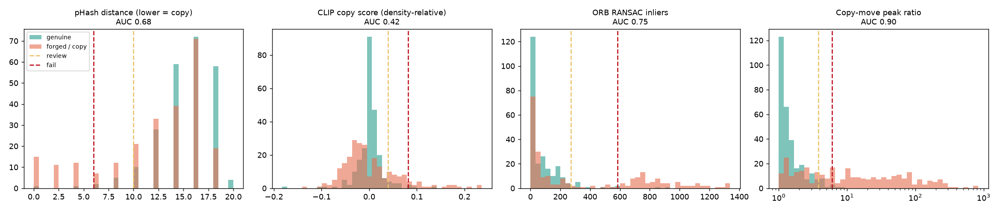
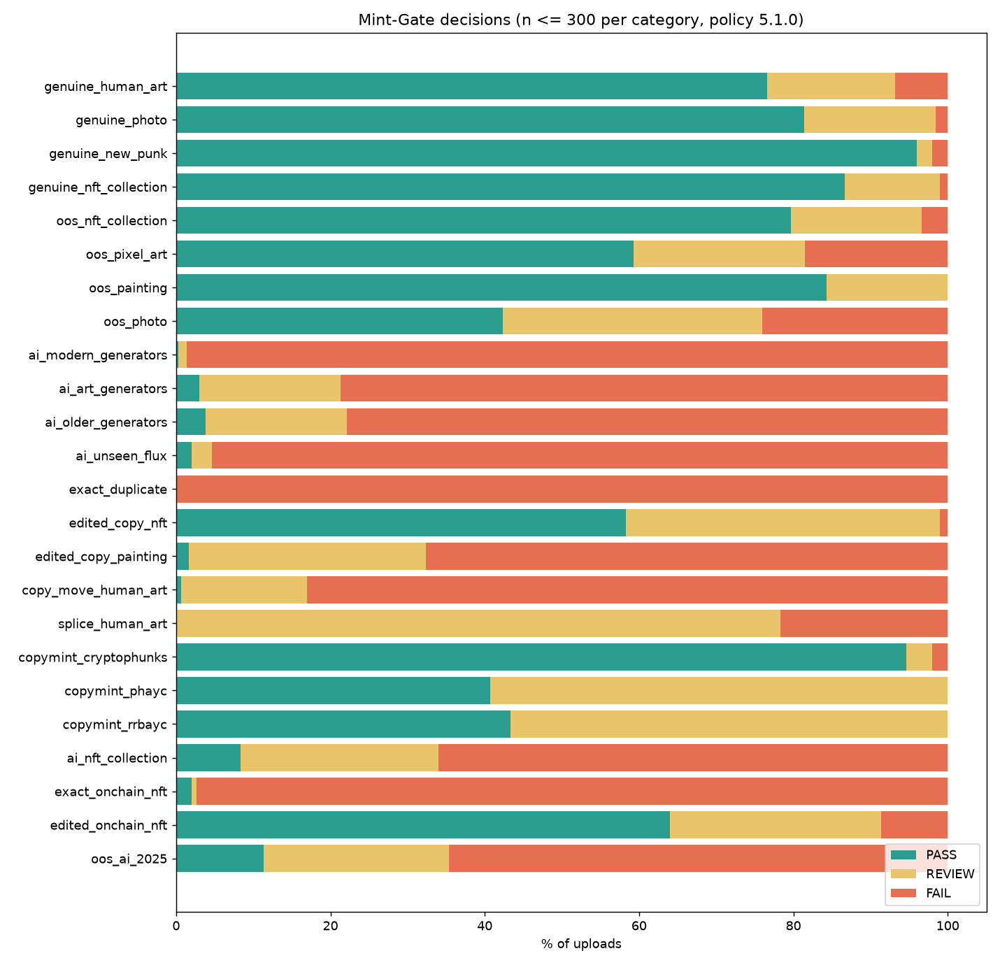

# Mint-Gate: AI Image Forensics as a Gate Before NFT Minting

**Project report**: Manasvi Patil · November 2026

## 1. Problem

An NFT proves *ownership and provenance* of a token, not the originality of its artwork.
Plagiarised, edited, cloned or AI-generated images mint as easily as originals, and a smart
contract cannot inspect pixels. Mint-Gate runs image forensics **off-chain before minting**.
It uses the blockchain for what it does well: a public, tamper-evident record of every verdict,
plus an on-chain rule that refuses to mint without a passing one.

## 2. System

| Stage | Technique | Role in policy v5.1.0 |
|---|---|---|
| Provenance (Phase 5) | raw upload bytes: C2PA manifest (signature chain verified), Stable Diffusion / SDXL DWT-DCT watermark, generator metadata (A1111, ComfyUI, IPTC XMP), optional reverse image search | status only: AI evidence → FAIL, advisory → REVIEW, trusted capture → AI detector capped at REVIEW |
| Preprocessing | format allow-list, decompression-bomb guard, RGB, SHA-256; *detector view* (same 256 px + JPEG normalisation as the training data) | — |
| AI detector (Phase 5) | linear probes on frozen CLIP ViT-B/32 + SigLIP 2 B/16 (weights 0.3 / 0.7), UnivFD recipe, chosen out-of-source | weight 0.45, can FAIL |
| `manipulation` (Phase 5) | TruFor (Noiseprint++ + SegFormer): score + localisation map; GPU profile only, non-commercial | weight 0.10, **REVIEW only** |
| Copy-move | 16×16 block matching, shift-vector voting; score = dominance of one displacement | weight 0.15 |
| `copy_semantic` (Phase 4) | SSCD + DINOv2-S fusion (+ 18 SSCD region crops on GPU), density-relative, vs one-off works | weight 0.20 |
| `copy_exact` (Phase 4, 5b) | PDQ 256-bit (8 dihedral hashes), exact in-memory search; collection members only when pixel-identical (128 px BOX, 8 dihedral variants, level 16) | weight 0.10 |
| `copy_member` (Phase 5b) | SSCD of the upload (as is + mirrored) vs the 10 nearest collection members; margin = cos − the member's own nearest-sibling cos | weight 0, **REVIEW only** |

The ResNet-18 of policies 3.x / 4.0 is retired (section 4.6).

Each check's value maps to a risk (0.5 at REVIEW, 1.0 at FAIL). The score is
`100·(1 − Σ wᵢ·riskᵢ)`. Any FAIL-level check gives FAIL; any REVIEW-level check or a score
below 70 gives REVIEW.

The **protected collection** is a Postgres/pgvector index of 284,861 references: 269,816 Ethereum
NFTs from 48 collections (Phase 4), the 15,037-work seed collection (9,000 CryptoPunks, 3,347 items
from real NFT collections, 2,690 museum/WikiArt paintings), plus everything minted through Mint-Gate.
v1's pHash, CLIP copy score and ORB were replaced after a copy-detection benchmark (section 4.5).

## 3. Data

| Version | Content | Result |
|---|---|---|
| v0 (original) | 10k CryptoPunks vs 8.6k AI paintings | 99.75 % accuracy, but it learned "pixel art vs painting" (domain shortcut) |
| v1 | + ImageNet photos, 7 GenImage generators, museum art | 85 % accuracy; mostly photos and 2022-era generators, little NFT art |
| **v2 (final)** | rebalanced towards what is minted | below |

**Dataset v2 (20,309 images):**
- Authentic (8,885): 3,700 real-NFT-collection images (BAYC, MAYC, Azuki, Trippy Toadz,
  CryptoSkulls, nftrex, Dooggies; all pre-2022, so human-made), 2,985 paintings
  (WikiArt / museums), 1,000 CryptoPunks, 1,200 photos.
- AI (10,424): DALL·E 3, Midjourney and SD3 (1,500 each), SDXL (666), AI-art generators
  (3,458), older generators (300 each).

**Splits:** random 80/10/10. **Flux (1,000 images) is held out completely** as `test_unseen`.

**Bias control.** In GenImage the real images are JPEG and the fakes PNG ("Fake or JPEG?",
Grommelt et al. 2024). Every image in both classes is resized to a 256 px short side and
re-encoded as JPEG (quality 88–96), and uploads get the same treatment at inference.

**Augmentation.** 35 % of authentic training images also appear with a synthetic copy-move or
splice, labelled *forged*. Robustness augmentations: random JPEG (q 60–95), rescaling, blur.

**Training.** ResNet-18, all layers, AdamW + OneCycle (max LR 3e-4), label smoothing 0.05,
mixed precision, batch 48, 10 epochs on an RTX 3050 Laptop GPU (~100 s/epoch). The best epoch
is chosen by validation ROC-AUC. The AI detector is a logistic regression on CLIP embeddings,
with C and the ensemble weight chosen on validation; the spectral model's weight came out at 0.

## 4. Results

### 4.1 In-distribution test (n = 2,212) and unseen generator (Flux, n = 1,000)

| Metric | ResNet-18 | CLIP-probe AI detector |
|---|---|---|
| Accuracy | 91.1 % | **92.8 %** |
| ROC-AUC | 0.974 | **0.982** |
| Precision / recall (forged) | 95.3 % / 89.6 % | — |
| Flux (unseen) caught | 95.3 % | **97.9 %** (AUC vs genuine 0.990) |
| After JPEG q=70 | 91.6 % (AUC 0.970) | — |
| After 50 % downscale | 89.4 % (AUC 0.959) | — |

ResNet per group: DALL·E 3 100 %, SD3 100 %, Midjourney 97.9 %, SDXL 95.3 %, manipulated 94.1 %,
paintings 89.8 %, photos 77.5 %; weakest on old generators (ADM 61 %, VQDM 55 %).

### 4.2 Out-of-source check

The test split shares *sources* with the training data: the same NFT collections, and the same
Rapidata compression pipeline as the held-out Flux images. So we also evaluated on 480 artworks
from **4 NFT collections never used in training** and **200 Flux images from a different
publisher**:

| | Genuine NFTs correct | Flux caught | ROC-AUC |
|---|---|---|---|
| **CLIP-probe AI detector** | **100 %** | **94 %** | **0.9998** |
| ResNet-18 | 64 % (CyberKongz 43 %) | 77 % | 0.79 |

**Finding.** The fine-tuned CNN partly memorised the collections it saw. Frozen CLIP features
generalise to new art styles and generators, replicating Ojha et al. The policy was redesigned
accordingly: the CLIP probe makes the AI decision, and the ResNet can only request human review.

### 4.3 Calibration (policy v3.1.0)

| Check | REVIEW / FAIL | Genuine flagged | AUC |
|---|---|---|---|
| AI detector | 0.675 / 0.925 | 5.1 % / 1.0 % (val) | 0.982 |
| ResNet-18 (REVIEW only) | 0.517 / — | 5.1 % (val) | 0.974 |
| Copy-move | 3.8 / 6.0 | 5 % | 0.90 (64 % of clones caught at 5 % false alarms) |
| CLIP copy score (paintings) | 0.059 / 0.088 | 5 % | **0.91** (60 % of edited copies caught at REVIEW) |

*Figure (regenerated in Phase 4): policy v4.0.0 copy checks `copy_exact` / `copy_semantic` on the
benchmark test split; the v3.1.0 rows in the table above are history.*

**Finding: collection density.** Genuine items of a generative collection are near-identical to
existing ones: CryptoPunk nearest-neighbour similarity is 0.99, Bored-Ape-type collections 0.94,
paintings 0.88. Applying pHash/ORB to collection members rejected 26 % of genuine Bored Apes in
an intermediate version. Those checks now apply only to one-off artworks, and collection members
are protected against exact copies.

### 4.4 End-to-end evaluation, policy v3.1.0 (n = 50 per category; v4.0.0: section 4.5 and README)

| Upload | PASS | REVIEW | FAIL |
|---|---|---|---|
| Genuine NFT-collection art | 88 % | 12 % | 0 % |
| Genuine pixel-art NFT | 82 % | 18 % | 0 % |
| Genuine painting | 76 % | 12 % | 12 % (6.7 % at n = 120; 2 of 8 are dataset duplicates) |
| Genuine photo | 62 % | 38 % | 0 % |
| Modern AI (DALL·E 3, MJ, SD3, SDXL) | 0 % | 12 % | 88 % |
| Unseen Flux | 0 % | 24 % | 76 % |
| AI-art generators / older generators | 12 % / 16 % | 42 % / 52 % | 46 % / 32 % |
| Exact copy of a protected work | 0 % | 0 % | 100 % |
| Edited copy of a protected painting | 4 % | 6 % | 90 % |
| Copy-move / splice forgery | 2 % / 0 % | 20 % / 84 % | 78 % / 16 % |
| Edited copy of a generative-collection NFT | 94 % | 6 % | 0 % |

Summary:
- Genuine uploads: 77 % PASS, **3 % wrongly FAILed**.
- Forgeries: **85.8 % stopped**, 58.4 % rejected automatically.
- **No modern-AI or Flux image passes.**

### 4.5 Copy detection v4 (Phase 4): benchmark first, then models

Built before any model was swapped: 4,000 protected works, 600 attacked copies (14 attacks incl.
collage and SD 1.5 img2img re-generation), 5,967 genuine distractors (NFT siblings, paintings,
photos) with the same attacks; DISC21 micro-AP, TPR at fixed FPR; tuned on val, reported on test.
Every component passed a val gate (≥ 0.005 micro-AP) or was dropped; full table: `docs/models.md`.

| Paintings (test) | micro-AP | TPR @ 1 % FPR | Recall@1 |
|---|---|---|---|
| v1 engine (pHash + CLIP + ORB) | 0.820 | 0.542 | 0.938 |
| SSCD alone | 0.909 | 0.868 | 0.993 |
| **SSCD + DINOv2-S + region crops (shipped, GPU)** | **0.905** | **0.896** | 0.986 |

Decisions: DINOv2-S over -B (tie, 4× cheaper); ALIKED + LightGlue rejected (+0.3 pp as a check:
ORB retired without a replacement); int8 ONNX rejected (SSCD 20× slower, DINOv2 lost accuracy).
Region crops cost 3.6 s on a 2-vCPU box, so the CPU profile runs without them (p50 1.10 s, p95
1.35 s per upload; GPU p50 0.83 s).

**What the small benchmark could not show** (found by re-running `evaluate_system` against the
live 285k index, each fixed and re-measured):
1. One HNSW graph over 280k clustered NFTs returned a painting copy's source only 51 % of the time
   (exact search: 100 %): one-off works got their own partial HNSW index (100 %).
2. A member rule calibrated on 1,500 CryptoPunks (PDQ + SSCD cosine ≥ 0.978) failed 36 % of genuine
   new punks against 9,000+: members now count only when pixel-identical (128 px nearest RGB,
   2× margin below the closest genuine val sibling; Phase 5b: BOX resampling, dihedral, level 16).
3. HNSW over PDQ bits missed 6 % of exact matches: PDQ is searched exactly in memory (9 MB).
4. The PDQ quality gate switched exact detection off for flat NFT art: re-uploads of indexed
   Ethereum NFTs passed 38 %; after the fixes 0 % pass (98 % FAIL).

Policy v4.0.0 on the benchmark test split: paintings 97.2 % of copies flagged / 2.2 % of genuine
(v1: 93.1 % / 5.0 %); generative-collection NFTs 0 % of genuine flagged (v1: 6.5 %).
End-to-end against the live index: 83 % of genuine uploads pass (v1 77 %), 3.5 % wrongly failed
(v1 3.0 %); exact re-uploads of indexed NFTs 98 % FAIL.

### 4.6 Phase 5: AI detection, manipulation forensics and provenance, with 95 % CIs

Every number here has n and a 95 % CI (Wilson for rates, stratified bootstrap for AUCs, paired
bootstrap for model comparisons); full tables in `docs/models.md`.

**Out-of-source protocol v2.** v1's check had saturated (CLIP-B/32 AUC 0.9998). The new set contains
only sources absent from training: 1,698 genuine images (947 NFTs from 47 unseen collections incl.
40 on-chain collections of the Phase 4 index, 54 pixel-art NFTs, 300 Rijksmuseum paintings, 397
COCO / DOCCI photos) and 733 AI images (2025-26 generators from OpenFake + Flux.1-dev). It is split
per group into a *select* half (ranking) and a *report* half (headline numbers). Primary metric:
balanced accuracy at the deployed review threshold, with every genuine domain weighted equally.

**AI detector.** Six frozen backbones (CLIP B/32 and L/14, SigLIP 2 B/16 and So400m, DINOv2 S and
B), all 15 probe pairs and a LoRA fine-tune were compared. Every SigLIP 2 / CLIP-L variant beat
B/32; DINOv2 lost; LoRA did not beat the frozen probe. The CPU budget excludes L/14 and So400m
(4-5 s per image). Shipped: B/32 + SigLIP 2, +4.6 pp [+1.8, +7.6] over v1 on the select half and,
on the report half (n = 1,191), AUC 0.925 [0.909, 0.938] vs 0.894 [0.875, 0.911], AI flagged
88.7 % [85.1, 91.6] vs 75.8 % [71.2, 79.9]. **Finding:** genuine photographs from new sources are
flagged 45-53 % by every detector (DOCCI 60-82 %), v1 included; adding permissively licensed
high-resolution photos to training halves DOCCI auto-fails but costs AI recall (not significant
overall, not adopted).

**Permissive profile.** Trained only on MIT / CDLA-Permissive data, the probe flagged 100 % of
paintings and photos (its only genuine class was NFT art). With 1,000 public-domain paintings and
800 CC BY photos added, it reaches OOS AUC 0.929 [0.914, 0.944] and 83.5 % AI flagged.

**Manipulation forensics.** On real forgeries ResNet-18 is at chance (AUC 0.486 COVERAGE, 0.579
CocoGlide, 0.501 IMD2020) and flags 43 % of genuine out-of-source NFTs. TruFor scores 0.769 / 0.768
(paired gain +0.28 / +0.19, CIs above 0), 98.3 % on Columbia, pixel F1 0.52 / 0.39 / 0.80, with 6-8 %
genuine false alarms; CASIA v2 and IMD2020 are in its training data and not counted as evidence.
Decision: ResNet-18 retired, TruFor REVIEW-only, GPU profile, never in the permissive profile.

**Provenance.** On 2,181 original files: 0 false hits on 1,452 genuine files ([0, 0.3] %), AI evidence
on 15.9 % [13.4, 18.8] of AI files (Midjourney 7 100 %, GPT-image-1.5 47.5 % via C2PA with an expired
OpenAI certificate, ComfyUI / A1111 metadata on z-image and Illustrious).

**End to end (policy 5.0.0, n = 300 per category, 20 categories; superseded by 5.1.0, section 4.7).** Genuine PASS 78.5 % [76.6, 80.3]
(n = 1,978), wrongly failed 6.8 % [5.8, 8.0]; forgeries stopped 87.1 % [85.9, 88.2] (n = 3,448);
modern AI FAIL 98.7 %, unseen Flux 95.3 %, 2025-26 generators stopped 88.7 % (64.7 % FAIL); exact
re-uploads of indexed Ethereum NFTs 98.3 % FAIL. False alarms (REVIEW or FAIL): collection NFTs
11.7 %, pixel art 11.9 %, paintings 19.5 %, photos 45.9 %.

**Retraining gate.** `training/retrain_gate.py` adds a new generator only if the OOS metric is
non-inferior (CI above -1 pp), no genuine domain's false alarms rise by > 2 pp, and the new
generator is caught at least as well. Demo with 420 HiDream-I1 images: already caught 40 / 40; the
retrained probe raised photo false alarms by 2.01 pp, so the gate refused it.

**CPU latency.** p50 1.5-1.6 s / p95 1.9-2.0 s on 2 threads: above the 1.5 s budget (v4 1.10 / 1.35 s).
int8 quantisation was rejected (-14.8 pp); an ONNX Runtime export saves ~180 ms but crashes next to
the copy engine on this Windows laptop and is deferred to the Linux container (Phase 7).

### 4.7 Phase 5b: real copymints and real AI NFT collections

Phases 4-5 measured copies made by *us* (attacks on indexed works) and AI images from generator
datasets. Phase 5b tests what is actually minted. Every contract was verified (Alchemy contract
metadata, Etherscan / OpenSea pages, the project's own statements); none of these tokens is in the
index. Full tables with addresses and evidence: `docs/models.md`.

**Copymints.** 300 tokens each of RR/BAYC (Ryder Ripps' re-mint of the Bored Apes, same art), Phunky
Ape Yacht Club (mirrored Bored Apes) and CryptoPhunks V2 (mirrored CryptoPunks), each uploaded as the
copy's own token file and paired with its original (pairing checked by a foreground pixel distance,
verified for all 874 copies whose original is indexed). The first run stopped every copymint, and was
wrong: two index bugs made siblings look like copies. Fixed, the Phase 4 rule let 69 % / 66 % / 97 %
of them through. Three bugs and one design limit explained it:
1. `repo.add_nft_items` never set `collection_member`: every BAYC row added after Phase 4 was treated
   as a one-off work, so its siblings "copied" it (fixed; 4k rows repaired).
2. `ingest embed` without `--follow` left `nn_sscd` empty, which disables the density-relative
   margin for those rows (now warns; repaired).
3. The member pixel rule compared NEAREST-resampled 128 px images *as uploaded*: a mirrored copy, or a
   full-size file against a thumbnail, never matched. A benchmark of 18 rule variants
   (`benchmark/member_rule.py`) shipped BOX resampling over the 8 dihedral variants at level 16: live
   genuine uploads wrongly matched to another token 45 → 6, benchmark member copies accepted 15 → 7.
4. **Limit:** no pixel statistic against 128 px JPEG thumbnails separates a copy of detailed art from a
   sibling. A new REVIEW-only check, `copy_member` (SSCD, as uploaded and mirrored, closer to a token
   than that token's own nearest sibling by ≥ 0.15), now catches re-mints without auto-failing
   anyone: benchmark genuine distractors 1 / 1,465, live held-out genuine 0 / 624.

Result (policy 5.1.0, copy engine 1.1.0): RR/BAYC stopped 56.7 % [51.0, 62.2] (was 31.3 %), PHAYC
59.3 % [53.7, 64.7] (was 34.0 %), with the right original named for 296 / 299 and 296 / 300.
CryptoPhunks stay at 5.3 % [3.3, 8.5]: mirrored 24 px punks are siblings to every signal at 128 px.
Storing larger reference images for the most-copied collections is the next fix (owner decision:
document now, fix later).

**AI NFT collections.** 518 tokens from 12 BrainDrops projects (AI art by named artists, method
stated per project) and Bastard GAN Punks V2, added to the out-of-source set as group `ai_nft:*`
(no retraining). The shipped detector flags 85.7 % [82.4, 88.5] (SigLIP 2 alone 81.3 %, CLIP-B/32
74.5 %); 100 % on five projects, 0 % [0, 8.8] on BGAN Punks (GAN-generated pixel art). OOS AUC with the
new group 0.911 [0.900, 0.920]. Provenance on the original files: no AI watermark or generator metadata;
18 / 518 carry Photoshop C2PA credentials declaring AI-assisted edits (advisory REVIEW). On-chain art has
essentially no provenance trail. End to end the gate stops 91.7 % [88.0, 94.3] of them (66.0 % FAIL).

**End to end (policy 5.1.0, n = 300 per category, 24 categories).** Genuine PASS 77.4 % [75.5, 79.1]
(n = 1,978), wrongly failed 6.2 % [5.2, 7.4]; forgeries stopped 78.5 % [77.4, 79.7] (n = 4,648): 87.4 %
[86.2, 88.4] on 5.0.0's categories, 53.2 % [50.4, 56.1] on the four real-world Phase 5b ones. Genuine punks
wrongly failed 6.0 → 2.0 %. Genuine collection NFTs pass 86.7 % (was 92.7 %): the extra REVIEWs are
uploads of tokens that are themselves indexed (22 / 23 checked point to the token itself), i.e. re-mints.

## 5. Blockchain layer

`MintGateNFT.sol`: ERC-721 + OpenZeppelin AccessControl, Solidity 0.8.24. Deployed on
**Ethereum Sepolia** at `0xae989b374DF85a942b4caE07940713Ff89418F32` (block 12,044,379);
source verified on Sourcify (exact match).

| Function | Role | Behaviour |
|---|---|---|
| `recordVerification` | VERIFIER | Stores every verdict immutably: report hash, image hash, score, decision, policy hash and version. Failures included. |
| `resolveReview` | REVIEWER | Human decision on REVIEW verdicts only. |
| `mintVerified` | VERIFIER | Reverts unless PASS / REVIEW_APPROVED. One token per report and one per image hash. |

- The artwork, ERC-721 metadata and full verification report are pinned to IPFS.
- `/api/verify` recomputes the report hash and compares it with the chain. A tampered report
  ("FAIL" edited to "PASS, 99") is detected, and the contract still refuses the mint.
- On start-up the server rebuilds its minted-artwork list from `VerifiedMint` events.
- Contract tests pass 7/7. The end-to-end flow (analyse → review → mint → verify → restart sync)
  was tested, and the production package was tested in production mode.

## 6. Limitations and future work

1. **Error rates (policy 5.1.0, n = 300 per category).** 6.2 % [5.2, 7.4] of genuine uploads are
   wrongly rejected and 16.4 % go to human review; 21.5 % of forgeries pass, mainly real copymints
   (RR/BAYC 43 %, PHAYC 41 %, CryptoPhunks 95 % PASS), edited copies of collection NFTs and 2025-26
   generators (11.3 % PASS).
2. **Photographs.** Genuine photos from new sources are the weakest domain (42.3 % PASS, 24.0 %
   FAIL out-of-source). Trusted C2PA camera credentials cap the AI detector at REVIEW; the real fix
   is high-resolution genuine photos in training, gated by `retrain_gate.py`.
3. **Generative collections.** Edited copies of collection items are indistinguishable from new
   siblings by appearance alone; only pixel-identical copies are blocked (TruFor now sends 34 % to
   review). JPEG re-uploads of textured collection art usually exceed the pixel budget. Real copymints of detailed
   art reach only REVIEW (`copy_member`): the index's 128 px thumbnails cannot prove identity, so larger
   reference images are the planned fix; mirrored CryptoPunks (CryptoPhunks) are still missed.
4. **Generators.** New generators appear monthly. The out-of-source protocol and the retraining gate
   (`training/retrain_gate.py`) are the process for them; one generator must stay held out.
5. **CPU budget.** The CPU profile is ~0.1 s (p50) to ~0.5 s (p95) over the 1.5 s target; the GPU
   profile is not. TruFor needs a GPU.
6. **Licensing.** Some training data and TruFor are non-commercial; the permissive profile
   (`MINTGATE_PERMISSIVE_ONLY=1`) avoids both, at its own measured accuracy.

## 7. Reproducibility

From `backend/`:
`training.fetch_realworld` → `training.fetch_v2` → `train_cnn --epochs 10` → `train_ai_detector`
→ `build_index` → `independent_check`. Copy engine (Phase 4): `benchmark.fetch_models` →
`benchmark.build_copydet` (+ `--regen`) → `benchmark.copydet features|crops|orb|lightglue|evaluate`
→ `benchmark.latency components` → `benchmark.copydet evaluate` → `calibrate --keep-detectors`;
on-chain index: `ingest fetch` → `ingest seed` → `ingest embed` → `ingest embed --rebuild-nn`;
Phase 5: `training.oos_data` → `training.ai_backbones fetch|features|evaluate|ship` (+ `--permissive-only`
after `training.fetch_permissive`) → `training.lora_finetune` → `benchmark.build_forgery` →
`benchmark.forgery fetch|run|evaluate` → `training.provenance_eval` → `calibrate` (+ `--permissive-only`)
→ `evaluate_system --n 300` → `benchmark.latency pipeline`, `benchmark.latency_ai`, `benchmark.int8_gate`,
`benchmark.onnx_backbones`; new generators: `training.retrain_gate`.

Outputs are in `backend/model/` (`model_meta.json`, `metrics.json`, `ai_detector.json`,
`system_eval.json`, `independent_check.json`) and `backend/policy.json`.
