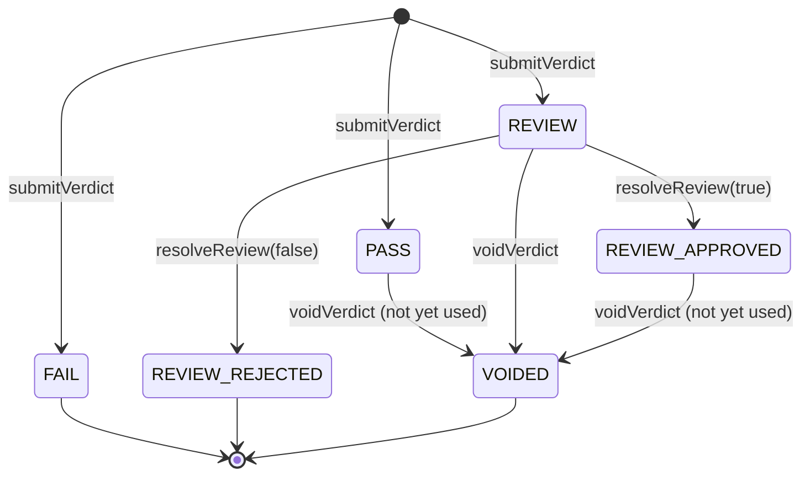
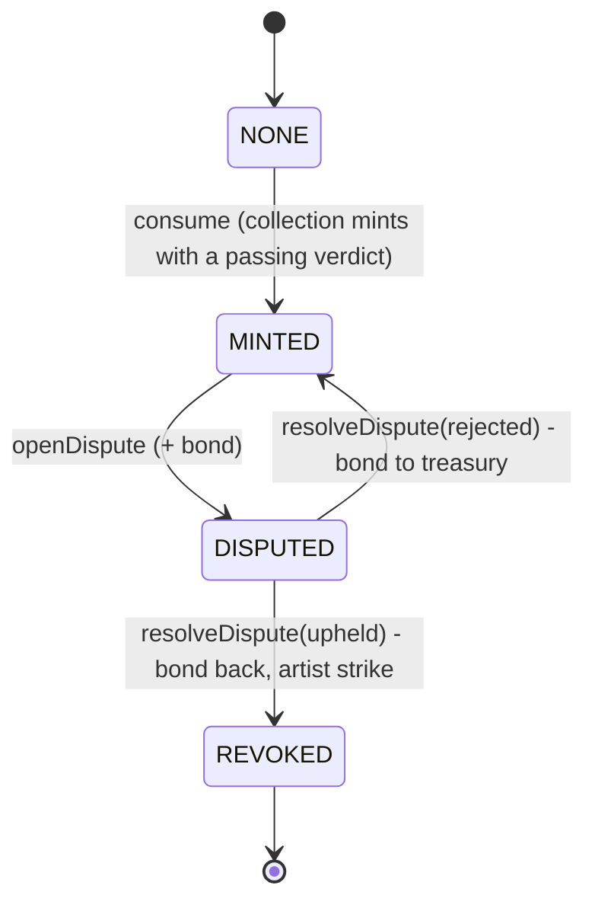

# Contracts v2: design

Mint-Gate v2 moves trust away from "the server's hot wallet records and mints everything". The
backend now only **signs** verdicts (EIP-712). Anyone can put a signed verdict on chain, and the
**artist mints from their own wallet** and pays their own gas. The verdict registry is a separate
contract, so any ERC-721 collection can use it.

v1 (`contracts/MintGateNFT.sol`, Sepolia `0xae98…8F32`) stays deployed and unchanged. v2 lives in
`Blockchain/contracts/v2/`.

| Contract | Role |
|---|---|
| `IMintGate.sol` | Interface + shared types (`Verdict`, `Decision`, `ImageStatus`). What third-party collections compile against. |
| `MintGateRegistry.sol` | Verdict registry: EIP-712 verification, review, voiding, one-mint-per-image, disputes, revocation, pause, roles. |
| `MintGated.sol` | Abstract base: inherit it to require a passing verdict in your own mint. |
| `MintGateNFTV2.sol` | Mint-Gate's own collection: artist self-mint, ERC-2981 royalties, ERC-4906 metadata updates, revoked status in `tokenURI`. |

## 1. Signed verdict (EIP-712)

Domain: `name = "MintGateRegistry"`, `version = "1"`, `chainId`, `verifyingContract = registry`.

```
Verdict(bytes32 imageHash,bytes32 reportHash,bytes32 policyHash,uint8 score,uint8 decision,
        address artist,uint64 issuedAt,uint64 expiresAt,uint256 nonce)
```

| Field | Meaning |
|---|---|
| `imageHash` | SHA-256 of the canonical pixels (same as v1). The global key: one token per image. |
| `reportHash` | SHA-256 of the full JSON report (kept off chain / on IPFS). Primary key of the verdict. |
| `policyHash` | SHA-256 of `policy.json` used for the decision. |
| `score` | Authenticity score 0–100. |
| `decision` | `1 PASS`, `2 REVIEW`, `3 FAIL` (only these three can be signed). |
| `artist` | Wallet that is allowed to mint. Bound by the signature. |
| `issuedAt`, `expiresAt` | Signature validity window for **submission** (max 30 days). |
| `nonce` | Random 256-bit value; one use per signer. Lets the verifier cancel an issued signature. |

`submitVerdict(verdict, signature)` is permissionless. It checks, in this order:
fields valid (`InvalidVerdict`) → not expired (`VerdictExpired`) → window ≤ 30 days and
`issuedAt` not more than 15 min in the future (`InvalidValidity`) → ECDSA recover with OpenZeppelin's
`ECDSA` (rejects malleable high-`s` signatures) → signer holds `VERIFIER_ROLE` **now**
(`UnauthorizedSigner`) → nonce unused (`NonceAlreadyUsed`) → `reportHash` not recorded yet
(`AlreadyRecorded`).

Every verdict is stored, FAIL included. The backend submits FAIL / REVIEW verdicts itself
(artists have no reason to); PASS verdicts go to the artist, who submits and mints in one
transaction (`MintGateNFTV2.submitAndMint`).

**Expiry covers submission only.** Once a verdict is on chain it stays valid until it is
voided or used. A REVIEW can take days, and expiring it while a human reviews it would be wrong.

## 2. State machines

### Verdict (keyed by `reportHash`)



A verdict is **passing** when it is `PASS` or `REVIEW_APPROVED`. The registry keeps a pointer to the
latest passing verdict per `(imageHash, artist)`; `voidVerdict` clears it. A FAIL never overrides an
earlier PASS (otherwise anyone holding an old signed FAIL could submit it to grief the artist).

### Image (keyed by `imageHash`, across all collections)



`REVOKED` is terminal: no function clears it. Revocation is a **status flag**; nobody burns a
token they do not own. The NFT shows it (`tokenURI` returns a "revoked" metadata document, the
original stays readable via `originalTokenURI`, royalties drop to 0) and emits ERC-4906
`MetadataUpdate` through `refreshMetadata(tokenId)`, which anyone can call.

### Dispute (keyed by `disputeId`)

`NONE → OPEN → UPHELD | REJECTED`. At most one open dispute per image. After a rejection a new
dispute (with a new bond) can be opened. The bond is snapshotted when the dispute opens, so
admin changes do not affect open disputes. Payouts use **pull payments** (`withdraw()`), so a
disputant contract that rejects ETH cannot block a resolution.

## 3. Interface

```solidity
interface IMintGate {
    enum Decision { NONE, PASS, REVIEW, FAIL, REVIEW_APPROVED, REVIEW_REJECTED, VOIDED }
    enum ImageStatus { NONE, MINTED, DISPUTED, REVOKED }
    struct Verdict { bytes32 imageHash; bytes32 reportHash; bytes32 policyHash; uint8 score;
                     Decision decision; address artist; uint64 issuedAt; uint64 expiresAt; uint256 nonce; }
    struct VerdictRecord { bytes32 imageHash; bytes32 policyHash; address artist; uint8 score;
                           Decision decision; uint64 issuedAt; address signer; uint64 expiresAt; }

    function submitVerdict(Verdict calldata v, bytes calldata signature) external returns (address signer);
    function isMintable(bytes32 imageHash, address artist) external view returns (bool, bytes32 reportHash);
    function consume(bytes32 imageHash, address artist, uint256 tokenId) external returns (bytes32 reportHash);
    function verdictOf(bytes32 reportHash) external view returns (VerdictRecord memory);
    function imageStatus(bytes32 imageHash) external view returns (ImageStatus);
    function isRevoked(bytes32 imageHash) external view returns (bool);
}
```

`MintGateRegistry` additionally has:

| Function | Who | Effect |
|---|---|---|
| `hashVerdict(v)` | view | EIP-712 digest (for off-chain signers and debugging). |
| `cancelNonce(nonce)` | any signer | Burns its own nonce, cancelling a signature it issued. |
| `resolveReview(reportHash, approved)` | REVIEWER | `REVIEW → REVIEW_APPROVED / REVIEW_REJECTED`. |
| `voidVerdict(reportHash)` | REVIEWER | `PASS / REVIEW / REVIEW_APPROVED → VOIDED` while unused (key-compromise clean-up). |
| `openDispute(imageHash, evidenceURI)` | anyone, `msg.value == disputeBond` | `MINTED → DISPUTED`. |
| `resolveDispute(disputeId, upheld)` | REVIEWER | `DISPUTED → REVOKED` (bond back, `strikes[artist]++`) or `→ MINTED` (bond to treasury). |
| `withdraw()` | anyone with credit | Pull payment of returned / forfeited bonds. |
| `mintOf(imageHash)` | view | `(collection, tokenId, reportHash)` of the one mint of this image. |
| `pause()` / `unpause()` | PAUSER / ADMIN | Stops `submitVerdict` and `consume` (minting). Reviews, voids, disputes and withdrawals keep working, because they are how an incident is cleaned up. |
| `setDisputeBond`, `setTreasury` | ADMIN | Parameters. |

`isMintable` is true when the registry is not paused, the image has never been minted in any
collection, and `(imageHash, artist)` has a passing verdict.

`MintGateNFTV2`:

| Function | Effect |
|---|---|
| `mint(imageHash, uri, royaltyBps)` | Artist (`msg.sender`) mints with a verdict that is already on chain. |
| `submitAndMint(verdict, sig, uri, royaltyBps)` | Submits the verdict (skipped if someone already did) and mints in one tx. Requires `verdict.artist == msg.sender`. |
| `tokenURI(id)` / `originalTokenURI(id)` | IPFS metadata; a fixed "revoked" document once the image is revoked. |
| `royaltyInfo(id, price)` | ERC-2981: artist, `royaltyBps` (≤ 10 %) chosen at mint; 0 once revoked. |
| `isRevoked(id)`, `imageOfToken(id)`, `tokenOfImage(hash)`, `refreshMetadata(id)`, `totalMinted()` | Status helpers. |

### Using it from another collection

```solidity
contract MyCollection is ERC721, MintGated {
    constructor(IMintGate gate) ERC721("Mine", "MINE") MintGated(gate) {}
    function mint(bytes32 imageHash) external {
        uint256 id = ++_last;
        _mint(msg.sender, id);                 // effects first
        _consumeVerdict(imageHash, id);        // reverts unless msg.sender has a passing verdict
    }
}
```

`_consumeVerdict` always uses `_msgSender()` as the artist, so a gated collection cannot mint
someone else's verdict. The registry admin must grant the collection `COLLECTION_ROLE`; see the
threat model for why this is not permissionless.

## 4. Roles and governance

| Role | Holder (testnet) | Can | Cannot |
|---|---|---|---|
| `DEFAULT_ADMIN_ROLE` | deployer → Safe multisig (Phase 6) | grant / revoke all roles, unpause, set bond / treasury | sign verdicts, resolve disputes (unless it grants itself the role, visibly on chain) |
| `VERIFIER_ROLE` | backend signing key | sign verdicts (off chain) | send anything on chain on the artist's behalf |
| `REVIEWER_ROLE` | human reviewer | resolve reviews, void unused verdicts, resolve disputes | mint, move tokens or bonds to itself |
| `PAUSER_ROLE` | on-call key | pause | unpause (admin only, so a stolen pauser key can only freeze) |
| `COLLECTION_ROLE` | `MintGateNFTV2`, vetted `MintGated` collections | `consume` verdicts | anything else |

Admin uses OpenZeppelin `AccessControlDefaultAdminRules`: there is exactly one admin, and handing
it over is **two-step with a delay** (`beginDefaultAdminTransfer` → wait → `acceptDefaultAdminTransfer`).
A typo in the new address cannot lose the contract, and the transfer to a Safe is visible before it
happens. Testnet delay: 1 hour (a mainnet deployment would use ≥ 2 days).

**Verifier key rotation** needs no redeploy: `grantRole(VERIFIER_ROLE, new)`, `revokeRole(VERIFIER_ROLE, old)`.
The role is checked at submission time, so every signature from the old key that is not yet on
chain becomes useless the moment the role is revoked.

## 5. Upgrade strategy: immutable contracts + registry pointer

No proxies. Every contract is immutable; `MintGateNFTV2` and every `MintGated` collection store the
registry address as an `immutable`. A new registry version means deploying a new registry and new
collections that point at it; the current addresses are published in
`backend/chain/deployments/<network>.json` (the off-chain pointer the backend and frontend read).

Why not proxies:

- **The upgrade key would be a god key.** Whoever can upgrade can replace "no mint without a
  verdict" with anything. That is exactly the trust this project tries to remove.
- **Users can read what they trust.** A verified, immutable source is the whole contract;
  with a proxy, the code that runs tomorrow is not the code that was audited.
- **Fewer bug classes:** no storage-layout collisions, no uninitialised implementations, no
  `delegatecall` surprises.
- **History survives.** Old verdicts, mints and revocations stay readable in the old registry
  forever; an indexer reads every registry listed in the deployments file.

The cost: a registry change does not move existing tokens. Acceptable for a provenance record,
where immutability is the point.

## 6. Threat model

| Threat | Mitigation |
|---|---|
| **Replay** of a verdict | `reportHash` can be recorded once; each `(signer, nonce)` once. Cross-chain / cross-contract replay is blocked by the EIP-712 domain (`chainId`, `verifyingContract`). |
| **Forged signature** | Signer must hold `VERIFIER_ROLE` at submission time. Any changed field changes the digest, so the recovered signer is a random address. |
| **Signature malleability** | OpenZeppelin `ECDSA.recover` rejects high-`s` and invalid `v`; replay protection does not rely on the signature bytes anyway. |
| **Front-running `submitAndMint`** | Someone copying the verdict from the mempool can only submit it first, which pays the artist's gas for them: `submitAndMint` skips submission if the verdict is already recorded, and only `verdict.artist` can mint. |
| **Someone else mints my verdict** | `MintGated` passes `_msgSender()` as the artist; the registry only consumes `(imageHash, artist)`. |
| **Malicious collection** | `consume` needs `COLLECTION_ROLE`. A permissionless `consume` would let any contract burn an artist's one mint per image, or mint it to itself. The admin grants the role only to collections that inherit `MintGated` unchanged and can revoke it. |
| **Griefing via disputes** | Each dispute needs a bond (`disputeBond`, 0.001 ETH on testnets); a rejected dispute loses it. One open dispute per image. Disputes never freeze the token: it stays tradeable and is only flagged after a reviewer upholds. |
| **Bond payout blocked** | Pull payments (`withdraw`); state is updated before the ETH transfer (checks-effects-interactions). |
| **Verifier key compromise** | `pause()` (PAUSER) → `revokeRole(VERIFIER_ROLE, leaked)` and grant a new key → `voidVerdict` every unused verdict whose `signer` is the leaked key (from `VerdictSubmitted` events) → dispute-revoke anything already minted → `unpause()`. The 30-day maximum window caps how long a stolen signature could have been valid. |
| **Admin key compromise** | Two-step admin transfer with delay; Phase 6 moves admin to a Safe multisig. |
| **Reviewer / pauser compromise** | Reviewer can at most flag tokens and settle bonds by the rules (bonds go to the disputant or the treasury, never to the reviewer). Pauser can only pause. Admin revokes either role. |
| **Re-entrancy** | All NFT state, the `Transfer` event and the registry update happen before the ERC-721 receiver callback (`ERC721Utils.checkOnERC721Received` is called last); a re-entrant mint sees consistent state and the one-mint-per-image check. |
| **Timestamp manipulation** | Only used for expiry windows measured in hours or days; validators can shift time by seconds. |
| **Detector is wrong** | Out of scope on chain: the registry proves *which* verdict and policy were used, not that it is right. Disputes are the correction path. |

Known limits: a dispute that no reviewer resolves keeps its bond locked (timeouts come with the
Phase 6 dispute process); two artists who both got a PASS for the same image race, and the
second must dispute the first.

## 7. Invariants (checked by the Foundry invariant suite)

1. **One token per image:** each `imageHash` is minted at most once across all collections, and the
   NFT's `tokenOfImage` / `imageOfToken` agree with the registry's `mintOf`.
2. **No mint without a valid verdict:** every minted token's report is `PASS` or `REVIEW_APPROVED`,
   was signed by a key that was a verifier when submitted, and names the token's minter as artist.
3. **Revoked stays revoked.**
4. **Solvency:** the registry's ETH balance equals open bonds + unclaimed credits.

## 8. Tests

| Suite | Command (from `Blockchain/`) | What it covers |
|---|---|---|
| Hardhat unit tests | `npx hardhat test` | 78 v2 tests (+13 v1): every function, every custom error, access control, pause, admin hand-over, key-compromise playbook, re-entrant and ETH-rejecting contracts, third-party collection. |
| Coverage | `npm run coverage` | 100 % statements / branches / functions / lines (gate: 95 %). |
| Foundry fuzz | `forge test --match-contract Fuzz` | 11 properties × 1,000 runs (CI: 5,000): digest = independent encoding, forged signer, tampered field, expiry, window, replay, high-`s`, only-the-artist, royalty cap, exact bond. |
| Foundry invariants | `forge test --match-contract Invariant` | The 4 invariants of § 7 over random sequences of 13 actions (submit, rogue submit, replay, review, void, mint in two collections, dispute, resolve, withdraw, transfer, key rotation, pause, time warp): 256 × 128 calls (CI: 512 × 256), plus a deterministic run that proves the handler reaches mints, disputes and revocations. |
| Python signer | `pytest backend/tests/test_eip712.py` | Digest and signature byte-identical to ethers.js; Python-signed verdict accepted by the contract on a local Hardhat node, replay and forged signer rejected. |
| Static analysis | `slither . --fail-medium` | No findings in v2 (see `docs/security.md`). |

## 9. Gas

`REPORT_GAS=true npx hardhat test` (Hardhat network, Cancun rules, optimizer 200 runs). Averages over the test suite:

| Call | Gas (avg) | Notes |
|---|---|---|
| `submitVerdict` | 189,422 | min 160k (FAIL), max 199k (PASS: also writes the passing pointer) |
| `MintGateNFTV2.mint` | 284,687 | verdict already on chain |
| `MintGateNFTV2.submitAndMint` | 409,771 | submit + mint in one tx (the artist's path) |
| `resolveReview` | 49,062 | |
| `voidVerdict` | 36,768 | |
| `openDispute` | 163,235 | stores the evidence URI |
| `resolveDispute` | 82,885 | |
| `withdraw` | 30,131 | |
| `refreshMetadata` | 32,501 | |
| Deploy `MintGateRegistry` | 3,355,843 | |
| Deploy `MintGateNFTV2` | 1,743,111 | |

For comparison, v1 needed `recordVerification` (140,877) + `mintVerified` (177,955) = 318,832 gas,
all paid by the server. v2 costs the artist ~410k gas in one transaction (royalty, registry
record, signature check), and the server pays nothing for PASS verdicts. On Base Sepolia at
0.006 gwei that is ~0.0000025 ETH plus the L1 data fee.

**Measured on Ethereum Sepolia (2026-11-02):** the same bytecode used **23,159,051** gas to deploy
the registry and 12,081,157 for the NFT, about 7× the Hardhat / Base Sepolia figures (3,355,855 and
1,743,111). The cause was not investigated (most likely newer L1 gas rules for contract creation on
Sepolia). Plan L1 deployments with that in mind and cap the priority fee (`PRIORITY_FEE_GWEI` in
`scripts/deploy-v2.js`). Ordinary calls are inflated too: `eth_estimateGas` for `cancelNonce`
(2026-11-03) gave 128,620 gas on Sepolia vs 45,892 on Base Sepolia (2.8×). Budget Sepolia calls at
3–7× the table above.

## 10. Deployments

`npx hardhat run scripts/deploy-v2.js --network <sepolia|baseSepolia>` writes
`backend/chain/deployments/<network>.json` (addresses, blocks, roles, ABIs);
`npx hardhat run scripts/verify-sourcify.js --network <...>` verifies through the Sourcify v2 API.

| Network (chainId) | `MintGateRegistry` | `MintGateNFTV2` | Blocks | Sourcify |
|---|---|---|---|---|
| Ethereum Sepolia (11155111) | `0xf45c9cB2358f1FC2D977Cff6d6661521e16349fB` | `0x59900d4F93fAb95F3B8aFBD4E9fEbF15Fa0F4f22` | 12048238 / 12048239 | exact match (both) |
| Base Sepolia (84532) | `0xae989b374DF85a942b4caE07940713Ff89418F32` | `0xf45c9cB2358f1FC2D977Cff6d6661521e16349fB` | 53508897 / 53508912 | exact match (both) |

Testnet roles: the deployer `0xeed8…eD7F` holds admin, verifier, reviewer, pauser and treasury;
admin delay 1 hour; dispute bond 0.001 ETH. Addresses are per chain (CREATE = deployer + nonce),
so the **Base Sepolia registry has the same address as v1 on Ethereum Sepolia**: always give the
chain together with an address. Etherscan / Basescan verification was skipped (no API key).
