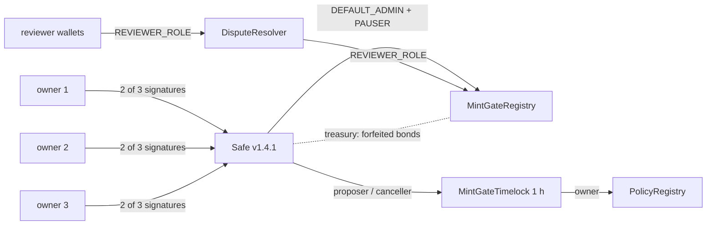

# Governance, disputes and runbooks (Phase 6)

No single key controls Mint-Gate. The registry's admin and pauser roles belong to a **2-of-3 Safe**;
the decision policy is announced in a **PolicyRegistry** owned by a **1-hour timelock** whose only
proposer is that Safe; every dispute decision is signed by an accountable reviewer wallet and carries a
**written reason** whose SHA-256 is on chain.

## 1. Contracts

| Contract | What it does | Owner / access |
|---|---|---|
| Safe (canonical v1.4.1 proxy) | Multisig; owners `0xeed8…eD7F`, `0x1F79…E2E2`, `0xCb03…57c2`; threshold 2 | itself (owner changes are Safe transactions) |
| `MintGateTimelock` | OpenZeppelin `TimelockController`, unchanged; delay 3,600 s | proposer + canceller = Safe; executor = anyone; **no admin** |
| `PolicyRegistry` | `setPolicy(sha256, version, uri)`; history, `current()`, `policyActiveAt(t)`, `isRegistered(hash)` | owner = timelock (`Ownable2Step`) |
| `DisputeResolver` | `resolveDispute(id, upheld, reasonHash, reasonURI)` → registry; emits `DisputeReasoned`; triggers ERC-4906 refresh | callers need `REVIEWER_ROLE` **on the registry**; no owner, no state |

The registry is immutable (docs/contracts.md § 5), so the reasoned resolution is a separate contract that
holds `REVIEWER_ROLE`. A reviewer can still call `registry.resolveDispute` directly; such a resolution
shows "no reason recorded on chain" everywhere (indexer, token page, explorer).

### Deployments (2026-11-11)

| | Ethereum Sepolia (11155111) | Base Sepolia (84532) |
|---|---|---|
| Safe 2-of-3 | `0xEdE58D8Ff74e72fc7568e68c8927a68884a290Fb` | `0x66bf57DC8ea2bE63dCa3CA4791d438FC38b02C67` (SafeL2) |
| MintGateTimelock | `0xC56840B470611668521fA00cA1d911f57431104F` | `0x1B2c47088CaE82b17690DF461FD05Fb3146a1c7d` |
| PolicyRegistry | `0xaa3d83420EB3f46C9765DF991F4559D04BF178Fe` | `0x7d56206Fa46A7Cd90c36E6588Cba407949e9A017` |
| DisputeResolver | `0xdb0490759F59dc31dd44a3A2d4F05756b37f48Cc` | `0xC56840B470611668521fA00cA1d911f57431104F` |

Addresses repeat across chains (same deployer + nonce): the Base Sepolia **resolver** has the address
of the Sepolia **timelock**. Always name the chain. ABIs and blocks: `backend/chain/deployments/<network>.json`
(`governance` block). Sourcify: PolicyRegistry and DisputeResolver exact match on both chains; the
timelock is a partial `match` (Sourcify's recompile differs in the metadata hash, although the deployed
runtime code is byte-identical to the repository build, metadata hash included; checked with `eth_getCode`).
The Safe singletons are the canonical, already verified deployments; `scripts/lib/safe.js` checks their
runtime code against the vendored v1.4.1 artifacts before every deployment.

Announced policies (`backend/chain/policies.json`, exact bytes pinned with `python -m governance policies --pin`):
`5.1.0-permissive` (`13125ec1…40e5`) and `5.1.0` (`0f356468…ca10`, `current()`).

## 2. Role map after the hand-over

| Role | Holder | Notes |
|---|---|---|
| `DEFAULT_ADMIN_ROLE` | Safe (two-step transfer, 1 h delay) | grants / revokes every role, unpauses, sets bond + treasury |
| `PAUSER_ROLE` | Safe | the deployer's pauser role was revoked |
| treasury | Safe | forfeited bonds: `withdraw()` as a Safe transaction |
| `VERIFIER_ROLE` | backend signing key (`0xeed8…eD7F` on testnets) | signs verdicts; rotate with the Safe (§ 4.2) |
| `REVIEWER_ROLE` | DisputeResolver + human reviewer wallets (testnet: `0xeed8…eD7F`) | resolves reviews and disputes |
| `COLLECTION_ROLE` | MintGateNFTV2 | granted at deployment |

What a single leaked key can do afterwards (tests: `Blockchain/test/v2/Governance.test.js`):

| Leaked key | Can | Cannot |
|---|---|---|
| deployer / verifier | sign verdicts until rotated (each still needs a mint by its artist) | change roles, bond, treasury, pause state or the policy |
| one Safe owner | nothing alone | anything: the Safe needs 2 signatures |
| a reviewer | flag / revoke tokens by the dispute rules (bonds never go to the reviewer) | mint, move tokens or bonds, change roles |
| the Safe (2 owners) | change roles and parameters immediately; a policy change only after 1 h, visibly | skip the timelock delay (the timelock has no admin) |

## 3. The dispute process

1. **Report** (token page `/token/<chain>/<contract>/<id>`, any wallet): statement, links, first-publication
   date, earlier on-chain claims and optionally the original file. The API pins the document (exact bytes,
   SHA-256 stored) and returns `openDispute(imageHash, evidenceURI)`; the reporter's wallet sends it with
   the bond (0.001 ETH). The token shows as *flagged*.
2. **Mint-Gate's evidence** (analysis worker, queued by the indexer after `DisputeOpened`): copy search of
   the disputed image against the reference index (the token itself excluded, each match marked if it
   was indexed before the disputed upload), the reporter's original compared with the disputed image
   (SSCD cosine, PDQ distance, identical pixels), the earliest signed submissions of both (Phase 3
   claims), and the reverse image search when configured. Pinned next to the reporter's evidence.
3. **Alert**: Discord webhook (`DISCORD_WEBHOOK_URL`, switch `NOTIFY_DISPUTES`; REVIEW uploads:
   `NOTIFY_REVIEWS`) with a link to the dispute.
4. **Decision** (Disputes tab, wallet with `REVIEWER_ROLE`, SIWE): side-by-side evidence, uphold or reject
   with a written reason of at least 20 characters. The API pins the reason document; the reviewer's own
   wallet sends `DisputeResolver.resolveDispute(id, upheld, sha256(reason), reasonURI)`.
5. **Outcome**: upheld → `ImageRevoked`, token metadata = `REVOKED_URI` (ERC-4906 `MetadataUpdate` emitted
   by the resolver), royalties 0, bond credited to the reporter (`withdraw()` on the token page);
   rejected → token active again, bond to the treasury (the Safe). The indexer writes `dispute.opened`,
   `dispute.resolved`, `token.revoked` to the append-only audit log; the API logs pinned evidence and reasons.

Service level (testnet): disputes are reviewed within 7 days. A dispute nobody resolves keeps its bond
locked (no on-chain timeout; the registry is immutable): the Safe can grant a second reviewer if one is
unavailable.

## 4. Runbooks

All Safe actions: `python -m governance propose <network> <action> [args] --sign` (from `backend/`; signs
with `SAFE_OWNER_KEY` or the network's signer key) creates the SafeTx, checks its hash against the Safe's
`getTransactionHash`, and stores it; other owners open **`/explorer` → Governance → "Sign as owner"**
(EIP-712 in their wallet, gasless); anyone then clicks **Execute** (or `python -m governance exec`).
`python -m governance list` shows the queue. A proposal executes at the Safe's next nonce only; proposals
with the same nonce are marked `replaced` when another one executes.

### 4.1 Complete the admin hand-over (once per chain)

`scripts/handover.js` (done 2026-11-11) granted PAUSER to the Safe, revoked the deployer's pauser role,
set the treasury to the Safe and began the admin transfer. After the 1 h delay, the proposal
`accept-admin` (already created and signed by owner 1 on both chains) needs one more owner signature on
`/explorer`, then **Execute**. Check: `registry.defaultAdmin()` = the Safe; `pendingDefaultAdmin()` empty.
**Done on both testnets 2026-11-13** (Sepolia tx `0x752b2f03…b6f2`, Base Sepolia tx `0x6add01f1…fd52`).

### 4.2 Verifier key rotation (planned or after a leak)

1. Leak only: `propose <net> pause` → 2 signatures → execute (stops `submitVerdict` and minting).
2. `propose <net> grant-role VERIFIER_ROLE <new>` and `propose <net> revoke-role VERIFIER_ROLE <old>` → execute.
   Signatures of the old key that are not on chain become useless immediately.
3. Set `VERIFIER_PRIVATE_KEY_<NET>` of the backend to the new key; restart workers.
4. Leak only: void every unused verdict signed by the old key (`voidVerdict`, reviewer), dispute + revoke
   anything minted with it, then `propose <net> unpause`.

### 4.3 Emergency pause

`propose <net> pause --sign`, a second owner signs on `/explorer`, anyone executes. Reviews, voids, disputes
and withdrawals keep working while paused (they are how an incident is cleaned up). `unpause` needs the
admin, i.e. the Safe again. A 2-of-3 pause is slower than a hot pauser key; the owner chose it so a
stolen key cannot freeze the registry either. For mainnet, consider a dedicated pauser key (can only pause).

### 4.4 Safe owner rotation (lost or leaked owner key)

The two remaining owners sign a Safe self-call `swapOwner(prevOwner, oldOwner, newOwner)` (Safe{Wallet}
UI or a raw proposal; covered by `Governance.test.js`). Update `owners` in the deployment file so the API
accepts the new owner's signatures. With two keys lost the Safe is unrecoverable: the admin role is then
stuck by design (the registry stays usable; deploy a new registry + collections, docs/contracts.md § 5).

### 4.5 Policy change

1. Calibrate and commit the new `backend/policy.json`; `python -m governance policies --pin` (writes
   `backend/chain/policies.json` with the SHA-256 and IPFS CID of the exact bytes).
2. `python -m governance propose <net> set-policy <version> --sign` → second owner signs → execute: the
   timelock emits `CallScheduled` (visible on `/explorer` → Policy history → Timelocked changes).
3. After 1 h anyone executes (`/explorer` "Execute now" or `python -m governance timelock-exec <net> <hash>`):
   `PolicySet`. Deploy the backend with the new policy only now; `/explorer` warns when the server's
   policy is not announced on chain.
4. The Safe can `cancel` a scheduled change during the delay.

### 4.6 Reviewer management

`propose <net> grant-role REVIEWER_ROLE <wallet>` / `revoke-role`. The API reads the role live (cached
60 s), so a revoked reviewer loses the dashboard within a minute. The shared `REVIEWER_KEY` for the REVIEW
queue is now a fallback for scripts; `REVIEWER_KEY_DISABLED=1` turns it off.
